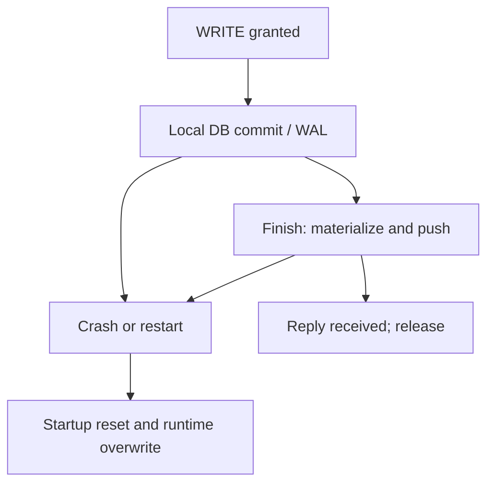
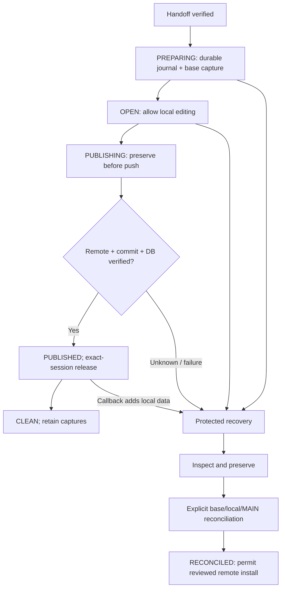

# E1B-1 — Durable local WRITE recovery journal

Status: CURRENT — safety implementation under validation; human review and post-publish report rollout blocker remain.
Base: `main_repos` `7cd8943703603a340e0d9dd4ac2102a908d81834`, including merged E1A #524.
Task contract: founder's E1B-1 R01–R05 prompt (no Issue number supplied).

## Persistence audit

| Boundary | Baseline evidence | E1B-1 behavior |
|---|---|---|
| Immediate Start Editing | `services/write_transaction.py::start_editing` acquires remote lease, runs authoritative handoff, enters EDITING, captures process-local generation/base, then best-effort raw DB copy | After handoff, persist PREPARING journal and verified base capture before EDITING. Failed journal/capture blocks editing. |
| Queued grant | `CollaborationManager::_grant_remote_request` verifies queue head/lock, runs runtime/UI handoff, emits grant; `on_write_granted` enters EDITING | Same durable preparation before transaction EDITING. Business `WriteGuard` rejects a lease projection without a matching OPEN journal. |
| Earliest local mutation | Repositories/services commit individual operations while EDITING; `mark_dirty` is an in-memory notification, often after the SQL transaction. Finish callback is not the first persistence boundary. | Establish recovery metadata before EDITING, independently of dirty notifications. The existing raw/unguarded writer bypass is not claimed fixed; see E1B-2. |
| Local SQLCipher commit | `database/engine.py` owns guarded DBAPI connections; `session.py` owns SQLAlchemy factory; engine uses NullPool. Committed data may remain in `center.db-wal`; main-file copy alone is insufficient. | Pending journal protects original DB/WAL. Preservation uses `runtime_database_publication_snapshot`: maintenance fence, drain tracked/native handles, checkpoint TRUNCATE with busy check, durable immutable snapshot, refresh factory. |
| Finish save / materialization | `finish_editing` validates finishing authority/base, invokes save callback, pending version, `artifact_security.materialize_runtime_database_to_repository` | Existing authority/Finance/version guards retained. Journal remains OPEN/pending through every intermediate failure. |
| Signed repository artifact | `artifact_security.py` validates ciphertext/key and signs stable database identity, hash and monotonic artifact generation; pair installation rolls back on failure | Reused unchanged. Recovery capture is explicitly local evidence, not a newly accepted signed MAIN identity; original signed sidecar and local pin are retained. |
| Git stage/commit/push | `GitSynchronizationProvider::publish_only` checks expected MAIN, stages/hash-checks business files, commits, single CAS push, pins identity. Reply may be lost after remote acceptance. | Durable PUBLISHING plus full pre-push preservation. True return alone does not clean: require fresh remote OID = local OID, current runtime snapshot = repository DB, and repository bytes = committed DB with clean working tree. UNKNOWN remains pending. |
| Release/cleanup | Publish success can precede verified exact-session release. Snapshot deletion/reset originally loses all process-local history. | PUBLISHED with VERIFIED publication; CLEAN only after confirmed release. Journal and captures are never deleted automatically. Release uncertainty is distinct from data publication. |
| Cancel | Dirty force-cancel restores old raw snapshot, deletes it after release. Dirty flag can omit committed operations. | For journaled sessions preserve current encrypted DB and Git artifacts even when dirty flag is false; mark CANCELLED, release through existing exact-session protocol, retain original workspace, require explicit reconciliation. No automatic rollback/merge. |
| Lease loss/idle/shutdown | Stale editing preserves memory only; manager shutdown may release lease but no durable local record existed. 30m idle logic relies on dirty flag. | Journal survives lease expiry/release/shutdown and blocks subsequent replacement. Existing 60s/600s/20s/30m policies unchanged. |

## Inventory and replacement audit

| Material/path | Distinct meaning and preservation |
|---|---|
| `runtime/Database/center.db`, `-wal`, `-shm` | Live encrypted database and WAL. A killed client retains original files. Recovery checkpoint captures every committed WAL effect; failure leaves recovery blocked. SHM is coordination state, not a separately accepted database. |
| `runtime/repository` including `.git` | Local commits, index, tracked/untracked artifacts and repository identity. Entire local Git tree/object store is retained, including unpushed commits and original accepted base. No automatic binary merge. |
| `runtime/metadata`, runtime attachments | Pending version/session metadata and local documents retained with capture. |
| In-memory forms/dialog drafts | Not committed SQL data. This journal does not serialize arbitrary widget state and cannot restore drafts after process termination. UI draft persistence remains an explicit blocker. |
| `Config/database_key.dpapi` | Existing user/machine-protected key bundle copied verbatim to local capture, with reference/hash. Raw key never serialized or logged. DPAPI remains bound to originating Windows profile; a capture is not portable key provisioning. |
| `Config/authoritative_database_identity.json` | Existing signed local identity pin retained as evidence; recovery never repins a local unaccepted snapshot. |
| `runtime.write-recovery/journal.json`, `captures/<unique>/manifest.json` | Sibling of runtime, outside Git and metadata restoration. PREPARING/OPEN/PUBLISHING/PUBLISHED/POST_PUBLISH_PENDING/CLEAN/CANCELLED/RECONCILED statuses. HMAC-authenticated SHA-256 manifest installed last, verified after copy; partial captures retained, never substituted for verified ones. |

Replacement paths inspected: canonical `platform/sync/startup_sync.py` (pre-clone/fetch/reset; DB and attachment materialization), `authoritative_runtime_sync_service.py` (handoff/background pull), hardened `write_handoff_runtime_sync_service.py::_apply_runtime_update`, provider hard reset/diverged pull/merge/checkout/clean, clone-failure repository deletion, deployment `_sync_repository_to_runtime`, `BackupService.restore_backup`, transaction `_restore_snapshot`, legacy base runtime materialization and offline `activate_clean_database.py`. Each supported destructive boundary checks the same journal. Bootstrap checks before default-runtime creation/provisioning. Legacy `platform/synchronization/startup_sync.py` delegates Git operations to the guarded provider; it is not canonical app startup.

`database/encryption_migration.py` is an explicitly controlled offline encryption utility; its destructive promotion now respects pending recovery. The inherited handoff already invokes `upgrade_installed_runtime_database_under_maintenance_to_head` before its session refresh. E1B-1 adds no migration or schema change and does not invoke that upgrader from preservation/inspection. If the inherited barrier changes runtime bytes away from accepted repository bytes, journal preparation refuses legacy equality; an operator must review the differing artifacts. This existing schema barrier is distinct from the SQLCipher encryption migration. SQL-level Admin data reset remains an authorized mutation under WRITE, with its existing pre-reset backup and Finance/admin controls; it is not a workspace replacement. Recovery does not authorize any reset operation.

## Journal durability and lifecycle

Atomic JSON write uses a private sibling file, file fsync, atomic replacement, POSIX directory fsync / Windows MoveFileExW REPLACE_EXISTING|WRITE_THROUGH. Capture files are individually fsynced; manifest installed last. Recovery never claims storage hardware survives arbitrary device failure, filesystem corruption, rollback or external deletion.

Before journal installation, no transaction EDITING permission exists. A crash after PREPARING installation blocks startup even if capture is partial. OPEN deliberately means *possibly modified*, without trusting `_has_changes`. Successful release cannot clean OPEN/PUBLISHING. Repeated preservation produces unique directories and retains every prior attempt. Begin archives prior clean journal history before creating another session.

Repository identity is a hash of configured origin identity, never a credential-bearing URL. Authority metadata contains observed session/revision/OID only; `ownership_epoch: null` is intentional. Artifact generation, in-memory lock generation and durable ownership epoch are different concepts. No epoch or end-to-end publication fencing is claimed.

## Before and after

Before:



After:



## Operator workflow

Stop CenterManager before preservation/reconciliation. Use the same provisioned Windows user and configured runtime. Source deployments run from `CenterManager` with `src` on PYTHONPATH:

```powershell
$env:PYTHONPATH = 'src'
python -m centermanager.platform.write_recovery inspect
python -m centermanager.platform.write_recovery preserve
```

`inspect` reads journal metadata only: no DB open, key load, network access, checkpoint, identity pinning or mutation. Missing metadata is explicitly LEGACY_NO_JOURNAL; corrupt metadata blocks. Review the preserved base OID, local DB/Git artifacts and currently accepted remote MAIN through an authorized operator. Inspect encrypted captures with the existing SQLCipher key and read-only `mode=ro`; never convert to plaintext for Git review.

After deciding to retain this local work as evidence and replace the active workspace with reviewed MAIN:

```powershell
python -m centermanager.platform.write_recovery reconcile --base <preserved-base-oid> --main <reviewed-main-oid>
```

The command observes fresh MAIN, rejects UNKNOWN/mismatch, creates and verifies another complete capture, then records explicit reconciliation. It neither publishes local data nor merges databases nor acquires WRITE. Startup can subsequently install accepted MAIN. Reapply selected business changes manually through a new normally authorized session after domain review. Do not delete captures/journal to bypass a blocker. Free disk space or resolve key/maintenance/file-lock failures, then retry preservation. Packaged operator UX/executable entrypoint remains follow-up work; the source CLI is the implemented recovery inspection path.

Legacy no-journal workspaces are admitted only when runtime DB exactly equals repository artifact, no nonempty WAL exists, working tree is clean and local HEAD equals its locally accepted upstream ref. Any uncertainty requires explicit preservation/reconciliation. Byte differences may conservatively block a semantically identical DB; this is preferable to discarding ambiguous work.

## Tests and evidence

`tests/test_e1b1_durable_write_recovery.py` exercises real SQLCipher, isolated bare Git, WAL, repeated captures, journal/snapshot/disk failure, destructive boundaries, Cancel without dirty notification, UNKNOWN acknowledgement, clean startup, legacy clients, explicit reconciliation preserving unaccepted commits, read-only inspection and real subprocess kills at explicit handshakes (before/after journal, committed live WAL, local publication commit before push, remote acceptance before receipt).

Synthetic key handling is injected for cross-platform deterministic tests; no production key/DB/lock is accessed. Mock-only lifecycle tests now explicitly use isolated runtime paths. Existing physical version/push-failure fixtures now seed an accepted synthetic DB base and wire the actual provider into collaboration; the version-success case performs a real isolated push instead of treating a mocked True return as acknowledgement. All existing conflict/version/authority assertions remain. Existing SQLCipher/DPAPI/security suites remain integration gates. Local focused before final integration gate: **39/39 recovery cases PASS**. Broader recovery/collaboration/security/activation integration: **100/100 PASS**. Windows handle diagnostics plus recovery/version/publish-failure focused suite: **54/54 PASS**. Full local suite and Windows CI remain in progress; no PASS is assumed for pending gates.

## Unresolved E1B-2 / E1C blockers

1. **No complete publication fencing:** authority lock CAS and data MAIN CAS remain separate; server-side proof tying a publication to current ownership/epoch is absent. Admin forced revoke remains prohibited.
2. **No durable ownership epoch:** observed OID/revision is a capability observation, not an epoch protocol. Journal is never an alternate authority.
3. **Raw/unguarded mutation bypass:** business WriteGuard is gated, but not every direct SQLAlchemy/DBAPI/service mutation is globally fenced against lease loss. Enforce the common mutation boundary in E1B-2 with an explicit migration/maintenance/auth-write contract.
4. **UI drafts:** unsaved widget state is not durable; crash recovery covers committed DB/WAL and local files, not arbitrary form text.
5. **Reconciliation UX and packaging:** source CLI supports read-only inspection, preservation and explicit retain-then-replace. A packaged guided reviewer, domain-level comparison/reapplication and cancel retry UX need E1B-2/E1C.
6. **Concurrent local processes / external writers:** preservation requires a stopped app for operator actions; existing app/runtime maintenance handles in-process DB ownership. A cross-process operation lock and protection against an older simultaneously running client/external tools require E1C. This PR cannot enforce policy on an old executable.
7. **Retention / disk capacity / recovery media:** captures are intentionally never automatically pruned. Define reviewed retention, disk reserve, key escrow/provisioning and disaster recovery before large deployments.
8. **Power loss/filesystem durability UAT:** process-kill integration tests are not physical power-cut proof. Exercise supported Windows/cloud-sync filesystems and DPAPI-profile recovery operationally.
9. **Post-publish report metadata (rollout blocker):** `MainWindow.on_publish_success` calls `ReportService.generate_student_report`, which commits report metadata after the accepted push. That is additional unaccepted local DB work. E1B-1 preserves it as POST_PUBLISH_PENDING, verifies normal release, shows read-only RECOVERY_REQUIRED and blocks sync/Start until explicit reconciliation. Student/attendance changes that generate reports can therefore require recovery review after an otherwise successful publish. Resolve the report finalization contract in E1B-2 before routine production rollout; this PR deliberately does not move the established post-success report trigger, implicitly push a second DB, or label those rows accepted.
10. **Controlled Emergency Revocation:** remains disabled until fencing, mutation guards, recovery/operator contracts and multi-client UAT pass.

No production database/lock modifications, schema migration, time-policy changes, force revoke, auto-merge or new WRITE authority.
