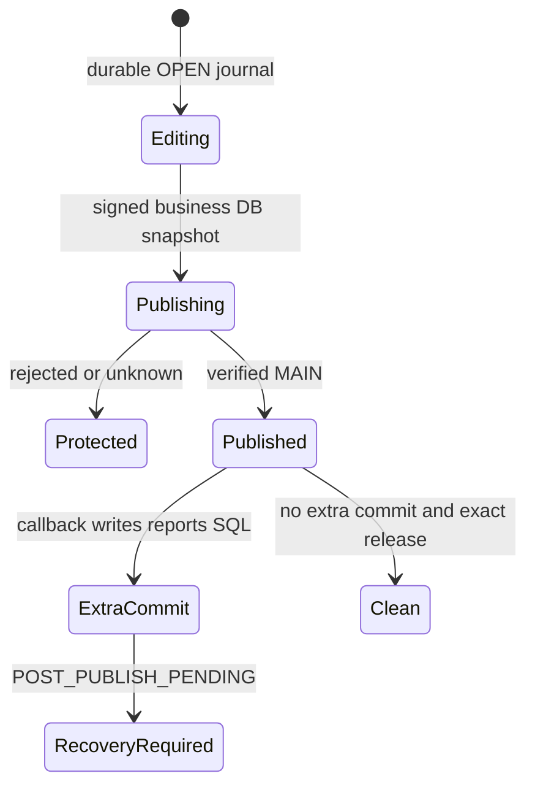
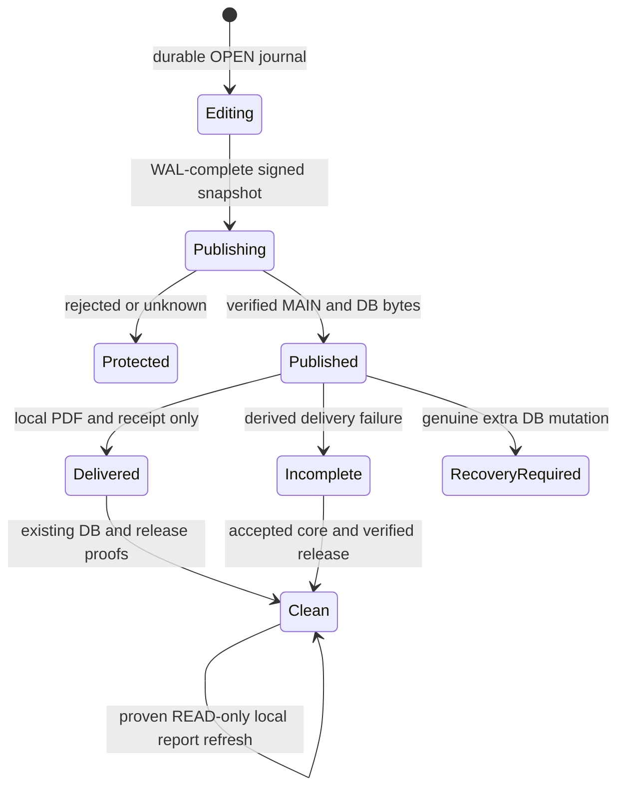

# E1B-2A — Post-publish data consistency

Status: implemented; final CI/review evidence is recorded in the associated PR.
Base: `main_repos` at `54dc3f7cd11825acc0c9bc6bbca3f89131da3eeb` (merged E1B-1 #525).
This audit supersedes earlier Student Workspace expectations that report generation must update SQL `reports`. Report content, permissions and E1B-1 recovery rules remain.

## Root cause and exact paths

Paths are relative to `CenterManager/src/centermanager`.

| Path / symbol | Before | After |
| --- | --- | --- |
| `ui/main_window.py: MainWindow._on_finish_editing.on_publish_success` | Dirty-student loop calls report generation after publish | UI only; separate core-published/reports-incomplete warning |
| `services/report_service.py: generate_student_report` | Render PDF, DELETE previous reports, INSERT Report, COMMIT | Local PDF/receipt only; no SQL DML or commit |
| `services/write_transaction.py: finish_editing → _publish_database_and_manifest → _publish` | Snapshot/sign/materialize, preserve, push, verify, callback commits DB, detect POST_PUBLISH_PENDING, release | Same authoritative lifecycle; SQL-read-only report delivery after verified MAIN, before existing mutation/release proofs |
| `ui/student_workspace/student_detail_page.py: _export_pdf` | READ-mode export had hidden SQL writes | Same export/list/open behavior through a local DTO; no DB writer |
| `services/auto_report_service.py: run_daily_check` | Same generating API per student, then Config scheduling marker | Same daily generation/retries; no SQL writes from generation |
| `export/pdf/student_report_generator.py: generate → _collect_data → _build_pdf` | Read service projections and build ReportLab PDF | Unchanged renderer, calculations and permissions |

The old callback's SQL DELETE/INSERT/COMMIT changed the SQLCipher DB after its authoritative snapshot was accepted on MAIN. E1B-1 correctly detected real unaccepted bytes/WAL effects. Suppressing that detection would discard legitimate data.

`StudentReportGenerator._collect_data` reads eager Student/Enrollment/Class/Teacher/Assessment relations, parents, Attendance/Session, notes, outstanding summary and last payment through existing services. It calculates enrollment groups, latest assessment, attendance rate, recent attendance/notes and Finance totals. These paths query rather than persist. The renderer writes its provided PDF, registers fonts and logs output; no mutation event is emitted. No Finance calculation/query contract changed.

Business rows, timeline, existing SQL rows (including legitimately changed legacy Report rows), signed identity and publication/version manifests remain authoritative. PDFs and newly generated presentation metadata (kind/trigger/actor/time/file/hash/source OID) are derived/rebuildable and now stored locally. Legacy SQL Report rows remain read-compatible and are never rewritten/deleted merely by generation. Explicit report deletion retains its WRITE boundary. No migration/backfill or historical data rewrite.

## Trigger, permission and performance audit

* Committed Student update/archive/activate/profile, Parent, Assessment and Enrollment events map to the existing aggregate dirty set. Delete marks the transaction dirty; an unavailable edited-then-deleted student is skipped without recreation.
* Attendance commits atomically in `_save_session_attendance_atomic`; `_publish_session_save_side_effects → _publish_student_attendance_updated` emits `StudentUpdated(changes=['attendance'])`, handled by MainWindow's StudentUpdated handler. Class-workspace attendance signals additionally refresh the current student surface.
* Enrollment commits/refreshes before StudentEnrollmentChanged. Policy helpers compute/defer triggers rather than rendering directly. Existing event-order/dirty-mapping tests remain.
* App binds `set_report_callback(report_service.generate_published_reports)`. After verified MAIN/DB acceptance, it attempts every sorted unique dirty student (latest/student_updated/system), collecting failures rather than skipping the rest. Report generation emits no recursive dirty event.
* Manual and daily exports use the same SQL-read-only API. Local report DTO IDs are negative student IDs; legacy SQL Report IDs remain positive. List/open prefer a valid local DTO, with legacy fallback.

Moving rendering earlier was audited and rejected: seeded Reception has Student update but lacks `lesson.view`, required by the existing renderer's SessionService query. Gating core publication on rendering would introduce a permission/dependency regression; bypassing the query check would weaken authorization. The final design keeps post-publish rendering SQL-read-only and reports delivery failure explicitly. An authorized account can regenerate; Reception's existing permission denial remains enforced. Real-renderer tests cover both roles.

Rendering stays outside SQL write transactions and the maintenance snapshot fence. It introduces no new lock, worker or WRITE session, does not delay the authoritative snapshot, and does not extend finish/lease/grace/renewal/idle deadlines. Normal delivery renders once per unique dirty student; all students are attempted despite individual failure. Large-batch release latency remains follow-up work; no performance SLA is claimed.

## Before and after lifecycle

Before:

After:

Start/journal creation, snapshot/signing/materialization, publish acknowledgement and exact-session release retain E1B-1 ordering. Lost push response remains PUBLISHING even if the remote actually accepted it; reports are not delivered on an unverified success path. `published(provider)` proves fresh remote/local OIDs and runtime DB bytes before delivery. `preserve_post_publish_changes` still runs after callbacks; genuine additional DB writes retain POST_PUBLISH_PENDING and encrypted captures. Only existing verified DB/release proofs can reach CLEAN; callback completion is never a clean proof.

## Derived file durability and pending protection

The local `.report.json` receipt records student ID/creation time, path, type/trigger/actor/time, metadata, PDF SHA-256 and source MAIN OID. Hash/provenance mismatch prevents an old PDF appearing current after accepted MAIN changes or ID reuse. Existing SQL rows remain readable; a corresponding invalid local receipt prevents opening an old file as current. Reports can be regenerated by an authorized account.

`WriteRecoveryJournal.begin_report_artifact_update` / `finish_report_artifact_update` admits only derived updates:

* Pending/PUBLISHING/POST_PUBLISH_PENDING/CANCELLED/reconciliation states reject generation before output overwrite. Captures, history and manifests are never modified/deleted by report operations.
* OPEN may render and stays OPEN. Verified PUBLISHED may render only while its DB hash/no-WAL proof matches; existing exact release owns finalization.
* CLEAN must already pass `assert_replaceable`. Afterwards the exact journal, repository identity/clean status/published HEAD, DB hash/no-WAL and all unrelated protected files must still match. Only one explicitly named PDF and matching receipt under runtime Reports/Export can refresh `accepted_local_files`. Status, publication, release, authority, base, DB proofs and captures remain unchanged.
* Legacy no-journal startup checks remain. Rendering does not invent a clean ownership receipt or resolve unknown work.

Unique candidates validate the PDF header, fsync and install using the existing Windows-aware durable `_install`. Prior good derived files are backed up under Temp (outside protected report fingerprints) and restored on synchronous failure. A crash between the two installs can leave a mismatched pair; CLEAN fingerprint checks then block replacement. This is fail-closed, not a two-file transaction claim. Paths outside runtime Reports/Export and student-code traversal are rejected. Immutable encrypted recovery captures are separate from temporary derived backups and never garbage-collected here.

## Failure behavior

| Failure window | Outcome | Preservation |
| --- | --- | --- |
| Manual report render/install/receipt failure before publication | Report fails explicitly; core not yet published | OPEN/business data retained, previous good pair restored, restart protected |
| Snapshot/signing/materialization failure | Existing authoritative failure | Journal, WAL-complete snapshots and Git artifacts retained |
| Rejected push or lost/unknown acknowledgement | Core unaccepted/unverified; no report success callback | PUBLISHING/recovery protection; no report overwrite or cleanup |
| Render/permission/disk/receipt failure after verified core publish | Core-published/reports-incomplete warning; other students still attempted | No SQL; CLEAN only via existing DB/release proofs; authorized READ repair available |
| Unexpected authoritative callback commit | New mutation unaccepted regardless of report result | POST_PUBLISH_PENDING/RECOVERY_REQUIRED, encrypted capture and repeated report attempts blocked |
| Unrelated DB/file mutation during CLEAN regeneration | Narrow derived refresh rejected | Unaccepted bytes retained and replacement blocked |
| Restart after normal Finish or derived-only delivery failure | Core accepted/released | Existing CLEAN proofs checked; missing reports remain unavailable/rebuildable |

No production DB/lock, real student/Finance data or real encryption key was accessed. Fixtures use a public synthetic key and isolated bare Git. Existing DPAPI references, signed identity, maintenance mutex, encrypted preservation, startup/reset protection and explicit reconciliation remain. No auto-merge, force release/revoke, schema migration, policy timing change or recovery deletion.

## Validation

`tests/test_e1b2a_post_publish_consistency.py` uses actual SQLCipher/WAL, SQLAlchemy write tracking, real isolated Git and ReportLab PDFs. It covers Student/Attendance/Enrollment content, multiple students, legitimate legacy SQL metadata changes, byte-identical DB for generation, READ/manual/daily reporting, pre/post-publication failures, disk/receipt failure, rejection/lost acknowledgement, restart, repeated protected attempts, source provenance, true extra callback SQL and unrelated-file protection. Deterministic failure injection uses a small renderer reading encrypted rows; additional cases use the unchanged production renderer and real services with Admin/Reception principals.

All E1B-1 cases remain required: process kills, WAL, startup/runtime replacement, unknown owner/state, cancellation, older clients and repeated preservation. Source tests now protect singleton local presentation instead of mandating SQL row deletion; event, repository, mutation and cleanup guarantees remain.

Run focused/full pytest from CenterManager. `.github/workflows/pytest-suite.yml` runs the full Windows/Python 3.10 suite and uploads JUnit/UI evidence. Final head/counts/run link are posted in the PR after execution. Local Linux retains the existing undefined `temp_repo` setup error in `test_e2e_sync.py::test_two_machine_sync` (already skipped on Windows). No new skip or workflow change.

## Remaining E1B-2B / E1C blockers

* E1B-2B: other callbacks/raw mutation paths, reentrant/cross-process writers and close/publish/release UI races; this is not a universal mutation fence.
* E1B-2B: large report-batch performance/cancellation and release latency, portable rebuild UX, daily/stale-cache retries, durable warning UX and derived crash-leftover retention. Existing renderer permission/content policy may require an authorized account for regeneration.
* E1C: durable ownership epoch, atomic lock/data publication fencing and real multi-client/power-loss testing. `ownership_epoch=None` remains; fencing is not complete.
* E1C: controlled Admin Emergency Revocation remains blocked on those prerequisites, preservation/key provisioning/access/retention operations and explicit reconciliation tooling/policy. No force revoke enabled.
* UI draft persistence and binary DB reconciliation remain separate; pending recovery is retained indefinitely, with no automatic merging or destructive cleanup.
