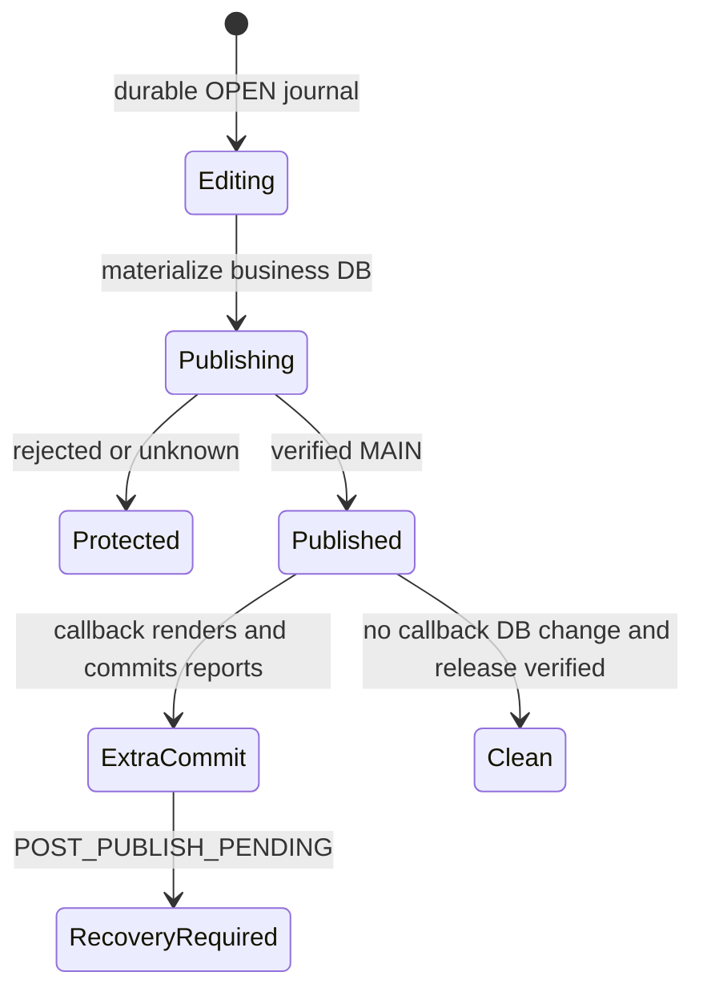
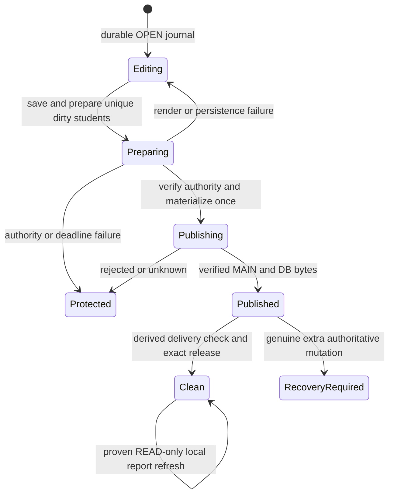

# E1B-2A — Post-publish data consistency

Status: implemented; Windows CI and review evidence belongs to the associated PR.
Base: `main_repos` at `54dc3f7cd11825acc0c9bc6bbca3f89131da3eeb` (merged E1B-1 #525).
This audit supersedes earlier Student Workspace tests/docs that required report SQL writes in the publish-success callback. It does not supersede the report content contract or E1B-1 recovery rules.

## Root cause and persistence inventory

Paths below are relative to `CenterManager/src/centermanager`.

| Path / symbol | Previous behavior | Authority / resulting change |
| --- | --- | --- |
| `ui/main_window.py: MainWindow._on_finish_editing.on_publish_success` | Read `dirty_student_ids`, call `ReportService.generate_student_report` once per ID after Git publish | Introduced a new DB commit after the accepted encrypted snapshot |
| `services/report_service.py: generate_student_report` | Render singleton `Reports/Student/<student_code>/StudentProfile.pdf`, delete previous `reports` rows, insert Report, commit | SQL metadata was authoritative persisted state even though PDF bytes are derived |
| `services/write_transaction.py: finish_editing → _publish_database_and_manifest → _publish` | Materialize DB/signature/manifest, preserve before-publish capture, push, verify remote/runtime, call success callback, detect additional mutations, release exact session | E1B-1 correctly detected the new SQL commit as `POST_PUBLISH_PENDING`; recovery was not a false positive |
| `ui/student_workspace/student_detail_page.py: _export_pdf` | Same generating API, explicitly available in READ mode | Hidden metadata WRITE without the canonical WRITE workflow |
| `services/auto_report_service.py: run_daily_check` (bound at app startup) | Same generating API per student; JSON last-run date under Config after completion | Hidden metadata WRITE in startup/READ; last-run marker is local scheduling state |
| `export/pdf/student_report_generator.py: generate → _collect_data → _build_pdf` | Read services, build ReportLab PDF, font registration; no SQL persistence or domain events | Rebuildable presentation of authoritative data; renderer unchanged |

`StudentReportGenerator._collect_data` reads Student with eager Enrollment/Class/Teacher/Assessment relations, parents, Attendance/Session, notes, outstanding summary, and last payment through existing services. It computes active/completed/withdrawn enrollment sets, latest assessment, attendance rate, recent attendance/notes and Finance amounts. The renderer writes only its provided PDF path; it does not update Student, Attendance, Enrollment, Finance or report metadata. No Finance formula/query contract changes are made here.

Business rows, timeline entries, SQL `reports` metadata, signed DB identity and publication/version manifests remain authoritative. PDFs, their local `.report.json` receipts, and the daily Config scheduling marker are derived local artifacts. Existing SQL metadata is retained and read as fallback; there is no schema migration or metadata backfill. Canonical report metadata is still singleton/latest for the dirty aggregate. A READ/manual/daily regeneration records local presentation metadata only, through a DTO rather than another SQL writer.

## Trigger audit

* Student create/update/archive/activate/profile changes commit before their existing timeline/events; StudentUpdated/lifecycle handlers mark dirty aggregates. Delete marks the transaction dirty; an aggregate edited and then unavailable is skipped by preparation, without recreating deleted students.
* Attendance `AttendanceService._save_session_attendance_atomic` commits the batch; `_publish_session_save_side_effects → _publish_student_attendance_updated` emits `StudentUpdated(changes=['attendance'])` per changed student. MainWindow's StudentUpdated handler marks the owning student dirty. The class-workspace signal additionally refreshes the current student surface.
* Enrollment commits and refreshes before `StudentEnrollmentChanged`; MainWindow marks its owning student dirty. Assessment events and parent events map to the same aggregate dirty set. Existing event and permission tests remain in place.
* Student/Attendance `ReportPolicy.check_and_trigger` computes/defer triggers; it does not render or write reports. Central Finish owns canonical preparation. Manual export and daily auto reports call the SQL-read-only generating API.
* Report generation itself emits no domain mutation event. SQL metadata preparation does not recursively mark students dirty.

## Implementation and lifecycle

`app.main` binds ReportService to `WriteGuard(collaboration_manager)` and registers `prepare_for_publication` / `verify_publication_reports` on the existing WriteTransactionManager. MainWindow's success callback only updates UI; it does not invoke report generation.

Before:

After:

1. Existing Start Editing/journal boundary is unchanged. The OPEN journal and base capture exist before local writes.
2. Finish saves local data and calls `ReportService.prepare_for_publication(set(dirty_student_ids))` before version creation, maintenance snapshot, signature/materialization and MAIN publication. Each sorted unique student is rendered once; metadata DELETE/INSERT/COMMIT uses the existing report repository provider under the canonical WriteGuard.
3. Rendering is outside the metadata transaction and outside the maintenance publication fence. Its read sessions finish before the short report-metadata transaction. File installation failures restore the previous derived pair. SQL failure prevents publication; earlier students' already-committed metadata remains protected by OPEN and is safely regenerated on explicit retry.
4. After preparation, `refresh_finishing_authority` rechecks session/generation, existing deadline and accepted MAIN. It does not extend the deadline or any lease policy. No new WRITE owner/session, scheduler, worker, heartbeat or lock is introduced.
5. The existing maintenance/WAL-complete encrypted snapshot, signed identity validation and Git publication then include business rows AND canonical report metadata. Existing E1B-1 `published(provider)` still requires fresh acknowledged MAIN/local OIDs and exact runtime DB bytes. UNKNOWN is never success.
6. After that verification, `verify_publication_reports` only checks PDF/receipt hash and writes a local receipt binding to accepted MAIN. There is no SQL call. Delivery failure becomes `report_warning`: core data published, local reports incomplete. MainWindow shows that warning and avoids automatic close. READ regeneration can repair the PDF without a second authoritative push.
7. Existing `preserve_post_publish_changes`, exact-session release/released acknowledgement and cleanup rules still execute. Callback completion never marks CLEAN. Additional DB writes still produce `POST_PUBLISH_PENDING` and retained captures; unverified release retains the existing release-pending state.

## Derived file updates without a second authority

The local receipt includes student ID/creation time, file path, report kind/trigger/actor/time, PDF SHA-256 and source MAIN OID. Local report DTO IDs are negative student IDs (existing SQL report IDs are positive). This allows report list/open/delete surfaces to use the existing service API. Legacy SQL report rows remain readable; a receipt that fails provenance/hash checks prevents its corresponding old PDF being presented as current. A new accepted MAIN invalidates the old derived receipt until regenerated. The receipt is local, not a publication acknowledgement or signed authority.

Manual/daily generation does not delete/insert/commit SQL metadata. A narrowly scoped `WriteRecoveryJournal.begin_report_artifact_update` / `finish_report_artifact_update` admits a PDF and its matching receipt under runtime Reports or Export:

* Pending/PUBLISHING/POST_PUBLISH_PENDING/CANCELLED/reconciliation states reject regeneration before any output overwrite. Existing immutable captures are never modified or deleted.
* OPEN may render locally, remaining OPEN. Verified PUBLISHED may render only while published DB bytes and WAL proof still match; the existing release boundary owns finalization.
* CLEAN must already pass `assert_replaceable`. After rendering, the exact journal document, repository identity/clean status/published HEAD, DB hash/no-WAL and every unrelated protected-file hash must still match. Only the two explicitly named derived files can update `accepted_local_files`. Status, publication, release, authority, base, captures and DB proofs are unchanged.
* The normal no-journal legacy startup checks remain unchanged. Rendering does not invent a clean legacy ownership receipt or resolve unknown/pending work.

Each output is rendered/staged uniquely, checked for a PDF header, fsynced and installed atomically using the existing Windows-aware durable `_install`. JSON uses the existing durable atomic helper where applicable. Previous derived outputs are temporarily backed up under Temp (outside protected report fingerprints), restored on synchronous failure, and never substituted for encrypted recovery captures. A crash between the two installs can leave a mismatched pair; the old CLEAN fingerprint then blocks replacement rather than accepting partial output. This is fail-closed, not a claim of a two-file filesystem transaction. Paths are constrained to runtime Reports/Export; student-code directory traversal is rejected.

## Failure matrix

| Failure window | Authoritative publication | User-visible / journal result |
| --- | --- | --- |
| Render, PDF staging/fsync/install, SQL report metadata persistence fails before publish | Not attempted | Finish returns incomplete, EDITING/OPEN retained, previous derived pair restored where possible, explicit Finish retry; restart protected |
| Long preparation loses authority or hits existing finish deadline | Not attempted | Existing stale/conflict state and OPEN data retained; no lease/deadline extension |
| Snapshot/signature/materialization failure | Not attempted | Existing E1B-1 fail-closed behavior; local business/metadata and captures retained |
| Core push rejected/returns false | Unaccepted | Existing failed/pending journal and snapshots retained; prepared metadata/PDF is not called published |
| Lost publish response/unknown remote | Unverified even if remote actually accepted | PUBLISHING/recovery protection; no report overwrite, cleanup or automatic reconciliation |
| Verified core publish, PDF missing/corrupt or receipt persistence failure | Business data and SQL metadata accepted | Core-published/reports-incomplete warning; no new SQL; CLEAN only after existing DB/release checks; local report repair remains possible |
| Genuine callback DB mutation after verification | New mutation unaccepted | POST_PUBLISH_PENDING/RECOVERY_REQUIRED with encrypted capture, even if report verification succeeded |
| Concurrent/unrelated file or DB mutation during CLEAN report generation | Not newly published | Derived receipt update rejected; unrelated bytes remain; startup replacement remains blocked |
| Restart after normal successful Finish | Verified and released | Existing startup/sync protection accepts the CLEAN proofs |

No encrypted key material, real student/Finance data, runtime DB or generated real reports are committed to this repository. Synthetic fixtures use a public test key and isolated bare Git remotes. Existing DPAPI key reference, signed identity, maintenance mutex and encrypted snapshot validation are reused unchanged. No automatic binary merge, reset, recovery deletion, force release/revoke, schema migration or policy timing change is introduced.

## Regression evidence

`tests/test_e1b2a_post_publish_consistency.py` uses actual SQLCipher, WAL, tracked SQLAlchemy sessions, ReportLab PDFs and isolated real Git publication. It verifies Student/Attendance/Enrollment changes, canonical SQL metadata on accepted MAIN, multiple dirty students/deduplication, READ/manual/daily availability with byte-identical DB, pre-publication render/metadata/disk failures, after-publication delivery/receipt failure, rejected/lost response, no SQL writes after acceptance, restart, genuine post-publish mutation capture, repeated blocked recovery attempts, provenance invalidation and unrelated-file protection. Its minimal PDF renderer reads the real synthetic encrypted aggregates; existing report content/rendering tests cover the unchanged production renderer.

The complete E1B-1 integration suite remains required, including process kills, startup/runtime replacement, WAL, unknown owner/state, cancellation, old-client handling and repeated preservation. Historical source-contract tests were updated only where they mandated the superseded post-publish SQL loop/implementation spelling; dirty-event mapping, singleton report behavior, repository boundaries and recovery cleanup assertions remain.

Run focused recovery/report tests and full suite from CenterManager. CI runs the full suite on Windows/Python 3.10 using `.github/workflows/pytest-suite.yml`, producing JUnit and UI evidence. Actual head, counts and Windows run link are recorded in the PR after execution. Local Linux has the pre-existing `test_e2e_sync.py::test_two_machine_sync` setup error (undefined `temp_repo`, already skipped by the existing Windows gate); this patch adds no skip.

## Remaining E1B-2B / E1C blockers

* E1B-2B: audit other post-publish callbacks and all raw DB/filesystem mutation paths, reentrant/cross-process writers, closing/publish/release UI races, and report-dirty coverage beyond existing Student aggregate events. This patch fixes the report lifecycle, not a universal mutation fence.
* E1B-2B: report batch performance/cancellation for large populations within the existing deadline, local report portability/rebuild UX on a different machine, stale-cache presentation, daily scheduling retries, and explicit retention/cleanup of derived crash leftovers. The current synchronous preparation is O(unique dirty students), with PERF logging, no performance SLA claim.
* E1C: durable ownership epoch plus atomic lock/data publication fencing and real multi-client/power-loss testing. E1B-1's `ownership_epoch=None` is unchanged; publication fencing is not complete.
* E1C: controlled Admin Emergency Revocation remains blocked on those authority/recovery prerequisites, encrypted preservation/key provisioning/access/retention operations and explicit reconciliation tooling/policy. No force-revoke capability is enabled.
* UI draft durability and manual reconciliation of binary databases remain separate work. Pending recovery artifacts are retained indefinitely here; no auto-merge or destructive garbage collection.
