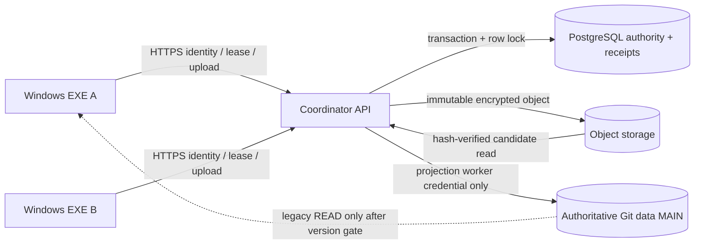

# E1C-02 — Coordinator Technical Design (ADR / Implementation Specification)

**Status:** PROPOSED — founder selected Option A in principle; **NOT IMPLEMENTED / NOT DEPLOYED**.
**Base:** `main_repos` `470b7385d60d776bde8e555396520a71fd99c9b9`.
**Depends on:** DEV-P0-01 architecture decision (PR #535), QA-P0-02 independent publication-fencing experiments, E1B-1/E1B-2B durability contracts.
**Scope:** architecture, API v1, persistence, security, staging/deployment, sizing and gated work packages. Zero changes to production behavior, data, credentials, cloud infrastructure or Git remote policy.

## 1. Decision and guarantees

Use **one authenticated coordinator service** as the **only principal with Git authoritative-ref write permission**. Clients can read accepted state and upload immutable encrypted candidate snapshots; only the coordinator accepts a candidate, holding an atomic database authority transaction, recording a durable receipt and updating the **authoritative accepted-data pointer**. Git MAIN is an asynchronously updated **projection** until atomic ref update completion; it is NOT an independently authoritative source during migration.

Required safety properties:

- S1: At most one authoritative active owner/epoch per repository; grant and revoke are serialized.
- S2: A publish is accepted **only** with valid user/role, client protocol, repository identity, exact session, epoch, unexpired lease, expected authority revision, expected accepted data OID and request idempotency key.
- S3: Never acknowledge acceptance before PostgreSQL commit durably records candidate pointer + receipt in **the same transaction**.
- S4: Duplicate `request_id` with identical canonical payload returns original outcome; reusing ID with changed payload is rejected.
- S5: Revocation and publication have a single database serialization order. If revoke commits first stale publication fails; if publish commits first data remains accepted and revoke reevaluates.
- S6: On coordinator or DB uncertainty, no new WRITE grants/publishes; local E1B journal/candidate remains protected.
- S7: **Remote permission denial**, rather than cooperation of the EXE, prevents direct MAIN updates by old clients. This is a *deployment property that must be QA-verified*, not supplied by API code alone.
- S8: Never overwrite accepted data or delete an unaccepted candidate during retry/restore.
- S9: Main snapshot changes are accepted by clients only after verifying coordinator pointer/receipt, encrypted DB identity, generation, SHA-256 and compatibility.

Explicit boundary: an offline uncontrolled legacy EXE can alter its private disk. The system guarantees **no unauthorized remote acceptance**, not instantaneous deletion of private unaccepted writes.

## 2. Architecture and trust boundaries

- **Windows EXE:** keeps SQLCipher local DB, runtime journal, saved/unsaved distinction, WAL-safe capture, read-only on unknown authority, protocol version gate; receives **no MAIN push credential** after cutover.
- **Coordinator API:** authenticated authorization, server clock/lease policy, per-repository serialized transactions, idempotency, immutable candidates, signed receipt, read-only current-state lookup. Do not expose a generic `git push` endpoint.
- **PostgreSQL:** sole source of ownership and accepted pointer, transactional CAS, unique request receipts and immutable audit log. One primary writer (no multi-leader).
- **Object storage:** content-addressed ciphertext blobs and signed manifest; upload existence alone never means accepted.
- **Git projector:** separately privileged worker. Writes data MAIN from accepted pointer in order; projection lag/error is observable, NOT authorization truth. Git ref protection still required against all direct desktop credentials.
- **Operations:** TLS, identity provider, secrets manager, encrypted backups, monitoring, disaster-recovery/runbooks.

**Critical compatibility:** existing production sync may currently treat MAIN as canonical. Before switching authority to coordinator, new client must fetch/verify coordinator receipt; old client must be denied WRITE or blocked at entry. A single flag switching API endpoint without this read-path migration is unsafe.

## 3. Minimal API contract (version 1)

All commands require TLS, authenticated scoped bearer token, `X-Client-Protocol: e1c/1`, repository-scoped permission, correlation ID; errors are stable machine codes. Never trust a client timestamp. JSON below represents schema, not proof of implementation.

| Method / route | Request core | Success response | Failure semantics |
|---|---|---|---|
| `GET /v1/repositories/{id}/state` | conditional etag | `epoch, authority_revision, owner_hint, lease_expiry, accepted_candidate_sha, generation, receipt_id, projection_main_oid, projection_lag` | Unauthorized/unknown identity; no secret tokens |
| `POST /v1/repositories/{id}/leases/acquire` | `request_id, expected_revision, client_session_id, protocol` | `granted / waiting, epoch, revision, server_expiry, queue_receipt` | `AUTHORITY_CONFLICT`, `UNSUPPORTED_CLIENT`, `QUEUED`, `UNAVAILABLE` |
| `POST /v1/repositories/{id}/leases/{session}/renew` | `request_id, epoch, expected_revision` | new revision/expiry | fail closed on expired/superseded, time from server |
| `POST /v1/repositories/{id}/leases/{session}/release` | `request_id, epoch, expected_revision` | durable tombstone receipt | old same-username session cannot release new owner |
| `POST /v1/repositories/{id}/candidates/init` | `request_id, ciphertext_sha256, size, db_id, generation, manifest_sha256` | short-lived upload capability, candidate ID | enforce size, sha, quotas, repository/user rights |
| `POST /v1/repositories/{id}/candidates/{candidate}/complete` | `request_id, artifact manifest, proof` | `VERIFIED_CANDIDATE` | no acceptance; validate blob hash and signed identity, SQLCipher using authorized key-validation design |
| `POST /v1/repositories/{id}/publish` | `request_id, session_id, epoch, expected_authority_revision, expected_accepted_candidate_sha, candidate_id, expected_generation` | `ACCEPTED, receipt_id, accepted_candidate_sha, epoch, new_revision` | `STALE_SESSION`, `REVISION_CONFLICT`, `DATA_CONFLICT`, `LEASE_EXPIRED`, `INVALID_CANDIDATE`, `UNKNOWN_OUTCOME` |
| `GET /v1/repositories/{id}/requests/{request_id}` | no mutation | authoritative receipt/result or definitively not found | read-only reconciliation on missing ACK |
| `POST /v1/repositories/{id}/leases/revoke` | administrator reason, exact expected epoch/session/revision, request_id | bumped epoch + tombstone + audit receipt | fail if target changed; require reconfirmation |
| `GET /v1/repositories/{id}/snapshots/current` | expected protocol, optionally if-none-match | signed accepted manifest + authorized download | never serve uncommitted upload as accepted |

API requests bind canonical payload hash to `(repository_id, principal_id, request_id)`; retries are **not** authorized to change parameters. `GET requests` must distinguish `UNKNOWN` from `NOT_ACCEPTED` when infrastructure is unavailable.

**Recommended response envelope:** `{request_id, status, server_time, authority_revision, receipt, error:{code,retryable,message}}`. Use HTTP 200/201 for verified success, 202 for queued/uploading, 409 CAS conflict, 403 authorization, 410 unsupported/expired session when appropriate, 422 bad candidate, 503 dependency uncertainty. No silent fallback to legacy Git push.

## 4. Persistence (PostgreSQL, durable transactions)

Tables (proposed keys and constraints):

1. `repositories(repository_id PK, protocol_min, protocol_max, accepted_candidate_sha NOT NULL, accepted_generation BIGINT, current_epoch BIGINT, revision BIGINT, state, owner_session_id NULL, owner_principal_id NULL, lease_expires_at TIMESTAMPTZ NULL, projected_git_oid NULL, updated_at)`.
2. `lease_sessions(repository_id, session_id, principal_id, epoch, issued_at, ended_at, end_reason, client_protocol, PRIMARY KEY(repository_id, session_id), UNIQUE(repository_id, epoch))`.
3. `request_receipts(repository_id, principal_id, request_id, request_hash, command_type, outcome, response_json, resulting_revision, created_at, PRIMARY KEY(repository_id, principal_id, request_id))`.
4. `candidates(candidate_id PK, repository_id, submitted_by, ciphertext_sha256 UNIQUE scoped to repository, manifest_sha, size_bytes, db_identity, proposed_generation, validation_state, storage_uri, created_at, retention_deadline)`.
5. `authority_audit(repository_id, revision, event_id, actor, session_id, epoch, action, prev_audit_hash, event_hash, request_id, committed_at, PRIMARY KEY(repository_id,revision))` immutable append-only.
6. `projection_outbox(event_id PK, repository_id, accepted_revision, candidate_id, state, attempts, next_retry_at, projected_oid NULL)` transactional outbox.

**Transaction pattern:** `BEGIN; SELECT repositories WHERE repository_id = ? FOR UPDATE`; check idempotency key and current owner/epoch/revision/expiry/data pointer using **DB server time**; reject on conflict; update single repository row and increment revision, insert receipt + audit + outbox event; `COMMIT`; only then return ACCEPTED. Order of locking must be consistent. Revoke uses *the same row lock* and increments epoch. Read-only state lookup may use consistent primary read; avoid stale replica for final authority.

Blob verified and durable **before** accepted DB pointer commit. Candidate GC may delete only provably unreferenced objects after a bounded retention period and completed recovery sweep; do not garbage-collect pending/journal references.

**Generation/identity:** coordinator enforces repository identity and monotonic accepted generation with signed identity sidecar. Any reinstall/restore must follow authorized restore permit and explicit signed provenance; never implicitly reset epoch after restore. A server-side SQLCipher content check requires a carefully approved key custody design; until that is approved the coordinator can verify ciphertext SHA, signed trusted manifest and provenance, with deeper integrity validation performed only at a trusted validation boundary. Do not overclaim that SHA alone proves DB decryptability.

**Projection conflict:** projector uses only coordinator-held credentials and exact expected Git MAIN OID; on conflict halt and alert, never force push. Outbox retries idempotently; projection lag cannot re-authorize stale desktop writes. Disaster recovery replays verified receipts + outbox rather than guessing from Git.

## 5. Lease, timeout, queue and failure semantics

- Retain current approved 30-minute inactivity and existing TTL/grace policy unless independently approved; coordinator holds authoritative wall-clock. Client monotonic clock only estimates when to renew.
- Acquire requires expected revision and server queue arbitration; FIFO for live requests with pinned queue receipt. Avoid client-side fabricated grants.
- Lease expiry without successful renewal: fail closed for commit/publish; preserve local recovery journal and private candidate. Do not retroactively declare committed local bytes remotely accepted.
- If local SQL commit and server acceptance are separated, acknowledge the business transaction as **locally saved, not yet published**. Client UI must not claim globally synchronized until verified receipt.
- Process crash between accepted pointer commit and HTTP response: replay `GET requests/{id}`, compare candidate hash/accepted pointer and receipt. Never blindly submit a different candidate under same id.
- Kill after verified server acceptance but before Git projection: accepted state remains authoritative; projector resumes by outbox; readers query accepted pointer.
- PostgreSQL outage / split brain: no new accepted commits, stale replica cannot grant WRITE, restore RPO/RTO must be explicitly selected and measured.
- Admin revoke can stop **future remote acceptance**, not an offline machine's private writes. Require reason, role, MFA/re-auth and exact target; no username-only force release.

## 6. Security controls and credential cutover

- **Identity:** user identities via managed IdP/OIDC or enterprise-approved equivalent. Short-lived access tokens with scopes, repository and principal audience; rotating refresh/session credentials; do not derive authorization from GUI role string.
- **Desktop:** no persistent Git MAIN write PAT after cutover. Protected local key material as required for SQLCipher; avoid logging SQLCipher keys, bearer credentials and student data. Protocol version check before WRITE.
- **Server:** strict RBAC: reader/editor/admin; least privilege Git projector separate identity; immutable append-only audit; deny direct MAIN writes to all desktop identities and legacy PATs.
- **Transport:** HTTPS TLS 1.2+, explicit server certificate validation, upload signed/short-lived URLs, size cap, upload checksum and malware/format checks where appropriate.
- **Storage:** encrypted server disks/object storage; secrets manager/KMS; backup database and object storage **together** with retention tested. Avoid storing user PII in coordinator logs.
- **Revocation:** admin step-up authentication + two-person approval option; preserve immutable reason/receipt. Stolen credentials monitored and revoked rapidly.
- **Security gates:** credential/token inventory (redacted), protected-ref permission proof, old-EXE direct-push denial, protocol downgrade denial, replay rejection, tenant/repository isolation, time skew and high-concurrency tests.
- GitHub branch protection API 403 for integration access in DEV-P0-01 audit; effective **data remote** permissions remain unknown until authorized operator inspection. Never assume source repository `main_repos` is the authoritative data remote.

## 7. Deployment and reliability

**Staging MVP (recommended):** FastAPI or equivalent typed Python API, PostgreSQL 15+ (supported version as chosen at deployment), R2/S3-compatible object storage, separate durable Git projection worker, reverse proxy/TLS, explicit staging-only data remote. Use migrations via Alembic; expose health/ready with DB and storage readiness. Start one server instance but rely on PostgreSQL row locking (not process memory) for authority; second instance after idempotency/load testing.

**Deployment environments:** `local_integration` (disposable SQLCipher/Git), `staging` (isolated credentials/remote), `production` (only after founder approval). CI runs DB schema migration test, authz/permission unit tests, Postgres concurrency, object-store failure injection, Git projector recovery and two EXE e2e; do not expose secrets in CI artifacts.

**Observability:** request trace and revision, owner epoch, denied stale publishes, reconciliation counts, candidate validation failures, projection lag and DLQ depth, DB transaction errors, backup verification. Alerts on divergent accepted pointer vs projected Git, unexplained generation, failed restore or dual-owner claims.

**Recovery:** periodic DB backups with point-in-time recovery where supported; immutable object retention; signed audit and receipt archival; restore into isolated staging to verify accepted candidate and revision monotonicity. Define RPO/RTO targets before pricing HA. No direct-Git legacy failover.

## 8. Cost model (November 2026 public list prices; estimates, USD/month)

Provider references:
- DigitalOcean Basic Droplets: 1 GiB **$6**, 2 GiB **$12**, 4 GiB **$24** / month (official advertised list price).
- Cloudflare R2 Standard: **10 GB-month storage**, **1m Class A** and **10m Class B** requests/month free; excess standard storage **$0.015/GB-month**, A **$4.50/million**, B **$0.36/million**.
- Hetzner Germany shared CX23 after June 2026 increase: **€5.49/month excluding VAT and IPv4** (regional price/hosting suitability and extra fees must be checked).

| Scenario | Monthly base infrastructure estimate | Caveats |
|---|---:|---|
| Local isolated development | $0 incremental cloud | Existing developer machines; no SLA |
| Staging proof of concept | **$6–$24** VM + low-volume R2 often within free allowance | Self-host DB on same VM = single point of failure, test only |
| Small single-node production (NOT HA) | **$12–$24** VM + R2 usage + backups/domain/monitoring | SQL DB on same host risky; not a final production sizing |
| Managed DB + app VM + object storage | **$12–$24 app VM + managed PostgreSQL quoted separately** | Preferred production posture; exact managed DB vendor/pricing not yet selected |
| High availability | Multiple app nodes + managed HA PostgreSQL + durable object storage | Quote after RPO/RTO, workload, region and privacy requirements |

Illustrative object cost: 30 GB-month Standard would be roughly **$0.30** storage after the 10 GB-month free allocation, excluding billable operation overages and applicable terms. Example assumes eligibility for free tier. Full costs also include monitoring, backups, egress outside R2, domains, local administration, compliance, incident support and engineering labor.

**Sizing inputs still missing:** encrypted DB size, snapshots/day, retention days, number of simultaneously active PCs, request rate, expected publication frequency, geography/latency, RPO/RTO, whether central server may hold SQLCipher decryption key, and required operating support hours. Do NOT present a definitive all-in cost until measured and quoted.

## 9. Work packages, acceptance and no-go criteria

- **E1C-02A:** schema migrations + transactional state machine; pure PostgreSQL serialization tests for publish-vs-revoke, duplicate request and stale revision.
- **E1C-02B:** upload/verify immutable candidate + manifest signatures, retention and failure injection.
- **E1C-02C:** scoped auth, API and typed errors; protocol downgrade and replay tests.
- **E1C-02D:** projector/outbox, exact OID handling, delayed/failed Git projection without loss of accepted pointer.
- **E1C-02E:** Windows client adapter (separate task) preserving E1B journal, SQLCipher local gate and accepted-receipt reconciliation.
- **E1C-02F:** isolated staging UAT with 2+ Windows EXEs incl. legacy, crash and disconnected publishers; demonstrate remote stale push denial.
- **E1C-02G:** credential and ref cutover runbook, backups, rollback (READ-only, not return old write permission).

**P0 NO-GO:** any direct legacy push accepted; ambiguous acceptance incorrectly marked SUCCESS/FAILED without reconciliation; pointer changed without durable receipt; missing candidate blob referenced by accepted pointer; two accepted active owners; database identity/generation regression; revoked owner publishes; raw legacy permission remains; server outage falls back to Git push.

## 10. Open founder/technical decisions

1. **SQLCipher key custody:** keep keys only on trusted Windows machines with signed manifests, or allow server-side decrypt integrity validation under tightly controlled KMS. This substantially affects threat model and cost.
2. **Data residence:** approved hosting region, personal-data handling, backup/retention policy and data access controls.
3. **RPO/RTO and outage policy:** default fail-closed WRITE; what hours of downtime are tolerable?
4. **Git projection:** continue Git MAIN as a compatibility/read projection, or retire after migration? Recommendation: keep read projection initially for audit/backup but never as authority.
5. **User identity:** source of trusted principals and admin step-up authentication.
6. **Expected data volume:** measure staging workload and obtain real managed-DB quotes before production launch.
7. **Credential cutover:** explicit approval to revoke desktop push identities; requires evidence that every authorized client can switch to coordinator.
8. **Admin revoke:** separate subsequent gated E1C feature, not included in E1C-02 initial implementation.

## 11. Next action

Approve this **technical design for staging prototype only**, not production. Implement E1C-02A (transactional state machine + tests) in a separate Draft PR. In parallel QA-P0-02 verifies legacy direct-push denial requirements and detects any practical existing bypass. Production switch and Git permission changes remain separate founder approvals.
