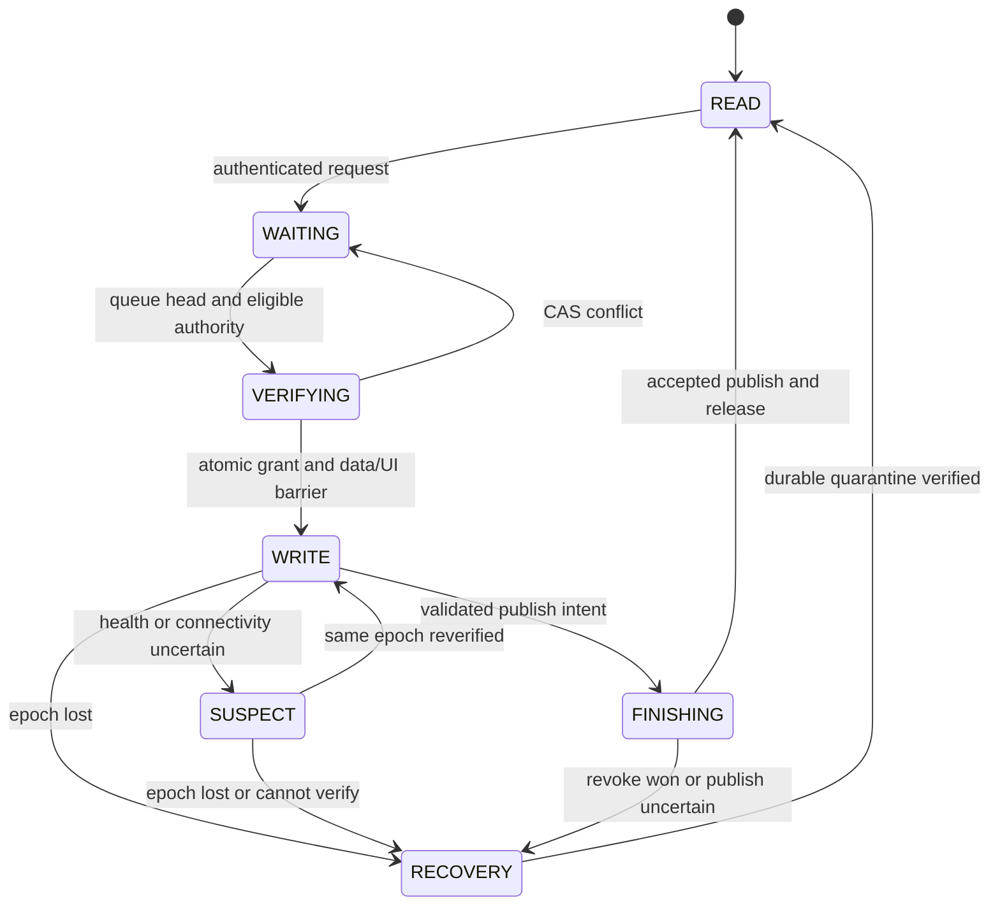

# WRITE authority fencing contract — proposal for founder review

Status: **PROPOSED / NOT IMPLEMENTED**. Base and evidence:
[E0 source audit](EMERGENCY_RECOVERY_SOURCE_AUDIT.md).
**Unilateral immediate Admin revoke is BLOCKED with current desktop Git clients.**

## Authority and health are separate

One authoritative record, not UI state, establishes the effective owner.
User inactivity follows the existing 30-minute policy. Health observations
(`HEALTHY`, `SUSPECT`) describe verified renewal/service/UI progress; they never
grant a successor. `LOST_AUTHORITY` denies mutation/publication and enters local
recovery. Integrate these observations into the existing transaction model;
do not add a competing owner flag. A missing response is UNKNOWN, not crash proof.

Authority predicate for a normal mutation/publication request:

`authenticated principal + permitted operation + exact repository identity +
current session ID + current durable ownership epoch + active authority state +
approved lease validity + expected data OID + compatible protocol version`.

The predicate must be enforced at the mutation/publication boundary; checking
it earlier and then sending an ordinary MAIN push leaves a TOCTOU race. A
monotonic elapsed clock is suitable for local liveness, not cross-machine lease
comparison. Coordinator time must be authoritative for new leases; outage/time
uncertainty fails closed. Existing grace/idle/TTL defaults are unchanged until
an independently approved time-policy migration.

## Recommended enforceable architecture

Use an authenticated coordinator as the sole writer of protected authority and
data refs. Clients may upload encrypted immutable candidate objects, but cannot
directly update authoritative MAIN or authority refs. Remove/rotate old shared
write credentials, restrict ref updates, and verify denial using a legacy
client before enabling revocation. This infrastructure change requires explicit
approval; E0 does not provision it or change repository settings.

A durable authority ref contains `{protocol, repository_id, epoch, session_id,
principal, state, lease_revision, expiry, accepted_data_oid, request_receipts,
audit_chain_head}`. It points to immutable data objects and append-only audit
events. Ownership epoch increases on grant/revoke and never resets on release;
release writes a tombstone instead of deleting history. Renewal increments only
lease revision. OID is CAS version, not an ordered numeric generation.

The coordinator validates a command against the latest record and replaces
that single ref by exact-OID CAS. A publish atomically advances the accepted
data pointer and audit receipt under the same epoch. A revoke atomically bumps
epoch, removes the old session, records a tombstone and receipt. This ref CAS
is the linearization point for both operations. On conflict, reread and return
explicit conflict/re-evaluate authenticated command; never silently retarget a
revoke to a newer session. A projected MAIN ref is not independently authoritative
and must never be read as accepted data without the authority record; alternatively
update both refs with a verified atomic server transaction.

If publish wins first, its accepted data is retained and revoke must be
reconfirmed against the new authority OID/accepted data. If revoke wins first,
old publish fails epoch/OID validation. Retrying a request ID returns its recorded
outcome; a reused ID with different payload is rejected. Two coordinator replicas
also use CAS and durable receipts; process locks alone are insufficient.

This proves uniqueness of **accepted remote authority/publication**. No Git
protocol can instantly stop an offline machine changing its private local DB
or RAM. Updated clients must deny local writes when verified authority cannot be
established, quarantine committed changes and never auto-publish on reconnect.
An offline unacknowledged client's local fence is UNKNOWN. Do not display “all
local writes stopped” or claim full E2 acceptance until that client acknowledges
its fence (or its managed process is independently verified stopped). Current
E2's literal all-local-boundaries gate therefore remains blocked for an offline
unmanaged client even after remote publication fencing is available.

## Conditional Git-only alternative

Possible for a fully managed, version-gated fleet in the **same Git remote**:
every publish changes both persistent authority ref and MAIN using
`push --atomic` plus exact expected OIDs on both refs. Authority update MUST be
a real changed commit, not an up-to-date/no-op refspec. Revoke must conflict on
that same authority ref and retain epoch/audit tombstone. Renewal and release
must also use the protocol. Unsupported atomic receive => fail closed, never
fall back to two pushes. A single canonical ref with immutable data pointer is
another cooperative design.

`test_e0_atomic_two_ref_prototype_rejects_stale_publish` demonstrates a stale
authority OID aborts MAIN as well on a disposable local bare remote. **This is
not a production proof**. Atomic capability for the target host, authorization,
audit durability and deployment/legacy denial remain unverified. Desktop-held
credentials permitting ordinary MAIN pushes can bypass this protocol; adding
epoch JSON, a second pre-push read or a MAIN sentinel commit alone is insufficient.
Prefer the coordinator when legacy writes cannot be technically excluded.

## State and ordering

These are conceptual states mapped to current EDITING/EDITING_STALE,
FINISHING/FINISHING_STALE/WAITING_FOR_COLLABORATION, PUBLISH_CONFLICT and WAITING
states. `RECOVERY` never calls normal reset/pull before quarantine. An uncertain
publish is reconciled by request ID and accepted data OID, not blind retry.

## Invariants and fencing points

| ID | Required invariant / enforcement |
|---|---|
| F01 | At most one effective remote session/epoch; all grant/revoke/publish transitions linearize on the same authority record |
| F02 | Service permission checks remain; central operation permit checked before local transaction, DML/flush and commit; denied/expired permits roll back |
| F03 | Existing in-flight local work is quiesced/cancelled at a safe boundary or quarantined as unaccepted work; Admin cannot certify local quiescence without acknowledgement |
| F04 | Snapshot/materialization/commit creation, every final push and every retry require a current permit; only coordinator accepts publication for that epoch |
| F05 | Legacy provider `publish`, `_push`, optional-base callers, reset/restore, password, audit and migration workflows cannot bypass F04; bootstrap and recovery require explicit distinct permits |
| F06 | Loss of epoch cannot be repaired by recapturing newest MAIN or reacquiring with stale edits; require explicit recovery/reconciliation against preserved base |
| F07 | Release includes principal/session/epoch and expected authority OID. Username-only or magic `force_release` never authorizes deletion |
| F08 | FIFO among live requests of equal priority; newcomer cannot bypass queue; queue sequence/liveness verified at atomic grant; request expiration/cancel race rechecked |
| F09 | Unknown connectivity, malformed record, audit failure, unsupported protocol, expired Admin auth, stale target or unresolved publish result => no emergency availability claim |
| F10 | Generation/audit history survives releases; idempotency binds request ID to full command digest and target; revoked epoch never renews |
| F11 | Accepted data and audit outcome are durable together; success follows CAS acknowledgement or authoritative receipt reconciliation |
| F12 | No automatic overwrite/delete of unpublished workspace; no promise to recover unsaved RAM after a hard process crash |

Local permit enforcement must cover SQLAlchemy bulk operations and raw DBAPI,
not just UI `can_edit` or a business decorator. Reuse existing DB maintenance
gate for quiescence but do not hold its mutex while synchronously calling GUI
or doing unbounded network work. A remote outage cannot prove lease validity;
implement a bounded verified permit and conservative suspend/resume handshake.

## Admin command and audit contract

Diagnostic reads never enter WRITE. Show owner/session, minimal machine ID,
epoch/revision/OID, expiry/grace eligibility, verified observation age, queue
head/length and precise Git error. `ACTIVE`, `GRACE`, `RECLAIMABLE`, `UNKNOWN`
are observations, never proof that a process has died.

Add `collaboration.emergency.recover` to canonical `core/capabilities.py`,
Admin-only and service/coordinator enforced. Verify current principal/role
against authoritative identity; local cached `role='admin'` or Git credentials
are insufficient. Require short-lived reauthentication for controlled revoke.

Command fields: immutable request ID and payload digest; authenticated Admin
ID; repository ID; target principal/session/epoch; exact observed authority OID;
expected accepted-data OID; action; mandatory reason; issued/expiry timestamps;
minimum protocol; safety preconditions and UI confirmation receipt. Do not
accept arbitrary process command/PID execution.

Level 1: targeted, expiring graceful request, independently authenticated and
durably recorded. Responsive owner explicitly chooses Finish Editing or save
recovery copy and relinquish. Decline/timeout stays diagnostic; do not silently
Finish on behalf of the owner.

Level 2: after approved rollout/fencing proof, CAS revoke the specific target.
Record actor, request digest, target/old/new epoch/OIDs, reason, authority/time
checks, accepted data, local preservation acknowledgement or UNKNOWN, outcome,
error class and eventual successor. Append tamper-evident signed/hash-chained
events in the coordinator-controlled record; a hash chain alone is not immutable
if clients can rewrite the ref. Audit failure blocks mutation. Lost response
shows pending/UNKNOWN until the command receipt is recovered.

Only after remote fencing is verified, preservation requirements are satisfied
and fresh data/runtime/UI barriers complete may the queue head become WRITE.
If any gate fails, stay READ/RECOVERY_BLOCKED. Remote Windows process termination
is excluded; it needs a separately authorized installed agent and connectivity.

## Unpublished work preservation

Preserve three distinct classes: durable local DB/WAL changes, unpublished Git
commits/artifacts, and unsaved UI form content. Current pre-edit snapshot is a
baseline, not a backup of later edits. `_has_changes` is a volatile hint and
does not prove all service-side commits or unsaved forms are captured.

Updated client workflow: disable new mutations, quiesce transactions, capture
a WAL-consistent encrypted snapshot using the existing maintenance/snapshot
boundary, retain manifest/signed identity/base MAIN/session/epoch and key
reference, archive unpublished Git objects, and export form drafts if supported.
Write a durable recovery index with hashes and outcome; fsync and verify before
any reset, runtime replacement, automatic sync, cancel restore or cleanup.
Do not export keys to audit logs or public Git. Failed preservation blocks local
replacement/relinquish and reports the unresolved data risk.

Restart must inspect this journal before normal startup sync. Returning revoked
session enters recovery without normal handoff pull; retained work opens as a
separate read-only copy. An authorized reviewer compares it against preserved
base and latest accepted data, then explicitly reapplies selected domain
operations under a new epoch. Never merge/overwrite binary DB snapshots blindly.
If device is offline, its durable data may only be preserved on that device;
the system must say “not collected/unknown”. Unsaved RAM after kill/power loss
cannot be guaranteed. A founder must accept that limit, not be shown a false
“no data loss” success.

## Approval gate

E0 does not claim these invariants hold today. Founder review must choose
coordinator vs fleet-managed atomic Git, local/offline guarantee semantics,
quarantine retention/access, and deployment/version gating. E1 may then proceed
in reviewable PRs; E2 diagnostics/graceful requests precede any controlled revoke.
No reduction of 600s grace, 60s TTL, 20s timer or 30-minute idle is included.
